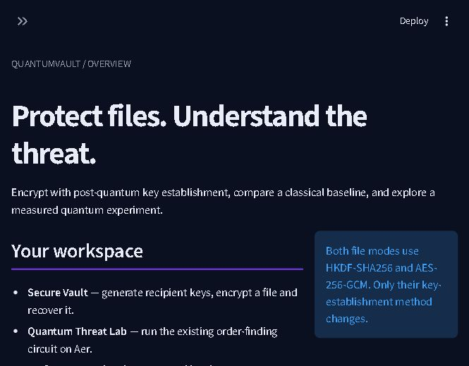
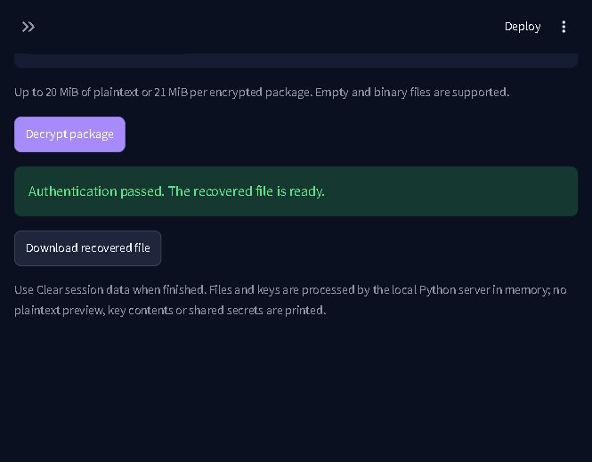
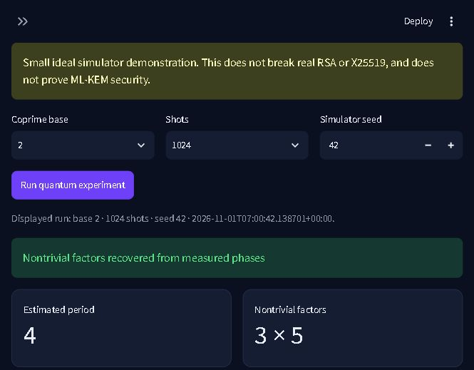

# piravi
# QuantumVault

Milestones 1–4: file encryption using ML-KEM-768 or an X25519 baseline,
HKDF-SHA256 and AES-256-GCM, measured key-establishment comparisons, and an
Aer-simulated quantum order-finding/factoring demonstration for N=15, connected
through a working Streamlit application. Requires Python 3.11 on Windows.
Milestone 5 (fresh-environment final verification and submission) remains incomplete.

## Open the application

From the project folder in PowerShell:

```powershell
.\.venv\Scripts\python.exe -m streamlit run app.py
```

Open **http://127.0.0.1:8501**. Use the sidebar to switch between all five pages;
in a narrow window, the double-arrow button opens or closes the sidebar.
The default configuration binds only to the local computer. Stop the server
with Ctrl+C in its terminal. For initial dependency installation, see Setup below.

## Setup (PowerShell)

```powershell
py -3.11 -m venv .venv
.\.venv\Scripts\python.exe -m pip install -r requirements.txt
.\.venv\Scripts\python.exe test_environment.py
.\.venv\Scripts\python.exe test_encryption.py
.\.venv\Scripts\python.exe test_classical.py
.\.venv\Scripts\python.exe -m benchmark.performance
.\.venv\Scripts\python.exe test_quantum.py
.\.venv\Scripts\python.exe -m quantum_lab.period_finding
```

If the Windows launcher is unavailable, use the full path to your Python 3.11
executable for the first command. Activation is optional.
Stop if pqcrypto cannot install or ML-KEM-768 cannot import; do not substitute
another algorithm. pqcrypto 0.3.4 is pinned for its byte-based API.
For the exact verified Windows/Python 3.11 environment, install with
`-r requirements-lock.txt` instead. All six environment checks and six encryption
tests passed on Python 3.11.9; `pip check` reported no dependency conflicts.

## Usage

```python
from crypto_engine.pqc import generate_pqc_keys
from crypto_engine.encryption import encrypt_pqc_file, decrypt_pqc_file

public_key, private_key = generate_pqc_keys()
package = encrypt_pqc_file(b"Confidential document", public_key)
recovered = decrypt_pqc_file(package, private_key)
assert recovered == b"Confidential document"
```

The version-1 binary format contains a fixed magic/version prefix, 1088-byte
KEM ciphertext, 16-byte HKDF salt, 12-byte nonce, then AES-GCM ciphertext with
its 16-byte tag. The full header is authenticated as associated data. Reject
authentication or parsing failures; never use unauthenticated plaintext.

This educational prototype assumes an authentic recipient public key and
does not authenticate the sender. Private keys stay separate from packages;
no keys are persisted automatically. Protect any exported private key. Files
are processed in memory; this API is intended for modest file sizes. It has
not undergone an independent security audit.

Tests cover shared-secret agreement, standard key sizes, empty/binary/1 MiB
round trips, randomized encryption, wrong keys, modified headers and payloads,
truncated packages and appended data.

## Classical X25519 baseline

```python
from crypto_engine.classical import (
    generate_classical_keys, encrypt_classical_file, decrypt_classical_file,
)

public_key, private_key = generate_classical_keys()
package = encrypt_classical_file(b"QuantumVault classical baseline test.", public_key)
assert decrypt_classical_file(package, private_key) == b"QuantumVault classical baseline test."
```

Each encryption generates a fresh ephemeral sender key. Its 32-byte raw public
key is transmitted in the package; the recipient's private key stays separate.
The X25519 version-1 format uses the prefix `QuantumVault-X25519` followed by
byte `0x01`, the ephemeral public key, a 16-byte salt, a 12-byte nonce, and
AES-GCM ciphertext with a 16-byte tag. The entire header is authenticated.
Its format is distinct from the existing, unchanged ML-KEM envelope.

Both workflows derive a 32-byte AES key with HKDF-SHA256 and use AES-256-GCM.
The HKDF context string is specific to each algorithm to separate their keys.
This follows the cryptography library's [X25519 exchange and key-derivation
guidance](https://cryptography.io/en/latest/hazmat/primitives/asymmetric/x25519/).
This baseline is an educational ephemeral-static construction, not a standard
HPKE implementation. It shares the public-key authentication and sender
authentication limitations described above. X25519 is a classical comparison,
not a post-quantum alternative.

The eight classical tests cover agreement and key sizes, empty/message/1 MiB
round trips, fresh ephemeral keys, tampering, incorrect keys, malformed
packages, invalid key lengths/low-order input, and cross-algorithm rejection.
All 14 classical and ML-KEM tests passed on the configured environment.

## Key-establishment benchmark

```powershell
.\.venv\Scripts\python.exe -m benchmark.performance
# The callable interface also returns a dictionary:
.\.venv\Scripts\python.exe -c "from benchmark.performance import benchmark_algorithms; print(benchmark_algorithms())"
```

`benchmark_algorithms(repetitions=30)` reports measured sizes and median
milliseconds for each operation after one untimed warm-up per operation:

- Key generation includes generating the recipient pair and exporting raw keys.
- Sender establishment includes encapsulation for ML-KEM; for X25519 it includes
  loading the recipient public key, generating a fresh ephemeral key, performing
  the exchange, and exporting the ephemeral public key.
- Receiver recovery includes loading byte-encoded keys and recovering the
  shared secret. Its recipient key and transmitted material are prepared outside
  the timed region and reused across repetitions.

HKDF, AES-GCM, package serialization and file I/O are excluded. Sender timings
therefore compare complete sender establishment, not only bare X25519 exchange.
The benchmark verifies shared-secret agreement before timing. Sizes are measured
from the backend outputs, rather than hard-coded into the results:

| Bytes | ML-KEM-768 | X25519 |
| --- | ---: | ---: |
| Recipient public key | 1184 | 32 |
| Recipient private key | 2400 | 32 |
| KEM ciphertext / ephemeral public key | 1088 | 32 |
| Shared secret | 32 | 32 |

The captured local run is in [benchmark/results.json](benchmark/results.json),
including timestamp, Python/library versions, platform, processor and timing
method. Results depend on the machine, backend and system load; 30 short
measurements describe this run and are not universal performance claims.
Actual file-encryption timings and package-size comparisons are deferred.

## Quantum Threat Lab (Milestone 3)

Implemented files:

```text
quantum_lab/
  __init__.py
  period_finding.py  # reversible modular multipliers, inverse QFT, Aer, CLI
  analysis.py        # measured-phase interpretation and gcd factor extraction
  results.json      # captured actual 1024-shot run, including circuit/configuration
  experiment.txt    # readable circuit, inverse QFT, counts and analysis from that run
test_quantum.py
```

This uses the existing dependencies: Qiskit **2.6.1**, Qiskit Aer **0.18.2**,
and NumPy **2.4.6**, verified in `.venv` on Python **3.11.9**. No new packages
were required. Use `requirements-lock.txt` to reproduce those installed versions.

### Circuit and classical post-processing

The default circuit has 8 counting qubits and 4 work qubits. It initializes
the work register to |1> and applies Hadamards to the counting register. For
counting qubit j it applies controlled multiplication by `a^(2^j) mod 15`.
Each multiplier is constructed from its full 16-state permutation:
`|x> -> |multiplier*x mod 15>` for x<15; the unused |15> state stays fixed.
Every supported multiplier is coprime to 15, so the mapping is reversible.
Identity powers are omitted. No period or expected counts are supplied to Aer.
This is a dense-unitary teaching implementation of modular multiplication,
not scalable arithmetic synthesis. It follows the phase-estimation structure
in the [IBM Quantum Shor tutorial](https://qiskit.qotlabs.org/docs/tutorials/shors-algorithm).

The explicit inverse QFT uses bit-reversal swaps, negative controlled-phase
rotations and Hadamards. It is independently checked against the mathematical
inverse Fourier matrix. Measurement strings use Qiskit's most-significant-bit
first convention; `int(bitstring, 2) / 2^counting_qubits` gives the measured phase.

Classical post-processing uses a bounded continued-fraction rational
approximation (`Fraction.limit_denominator(14)`). Its denominator r is accepted
only when `a^r mod 15 == 1`. For even r, the gcd step tries
`gcd(a^(r/2) - 1, 15)` and `gcd(a^(r/2) + 1, 15)` and verifies that two
nontrivial factors multiply to 15. There is no classical order search and no
fallback to known factors. Zero phases carry no information; for a=2, a phase
of 1/2 gives denominator 2, which fails modular verification. Such outcomes
remain inconclusive rather than being silently repaired. Even a verified
period may fail to factor: a=14 has period 2 but the gcd step is trivial.

### Run and display

```powershell
.\.venv\Scripts\python.exe test_quantum.py
.\.venv\Scripts\python.exe -m quantum_lab.period_finding
# Optionally save a fresh result (overwrites the named output file):
.\.venv\Scripts\python.exe -m quantum_lab.period_finding --shots 1024 --seed 42 --output quantum_lab/results.json
# Demonstrate an honest unsuccessful factoring result:
.\.venv\Scripts\python.exe -m quantum_lab.period_finding --base 14
# All security and quantum tests:
.\.venv\Scripts\python.exe -m unittest test_encryption test_classical test_quantum -v
```

The CLI prints the actual circuit, expanded inverse QFT, measured counts,
per-outcome interpretation, estimated period and factors. Its standard output
uses UTF-8 for Windows circuit rendering. `run_period_finding()` returns the same
data as a JSON-serializable dictionary for later interface integration.
`build_period_finding_circuit()` also exposes the Qiskit circuit itself.
The callable accepts coprime bases 2–14, 2–8 counting qubits, 1–100000 shots,
and an optional simulator seed. Only N=15 is supported.

### Captured experiment and verification

The actual run on 1 November 2026 used base 2, N=15, 1024 shots and seed 42,
on AerSimulator's ideal CPU `statevector` method, one simulation thread,
transpiler seed 42 and optimization level 1. Configuration, versions and compiled
circuit statistics are saved in [results.json](quantum_lab/results.json).
The circuit and readable report are in [experiment.txt](quantum_lab/experiment.txt).

| Measured bits | Phase | Observed shots | Interpretation |
| --- | --- | ---: | --- |
| 00000000 | 0 | 240 | Inconclusive |
| 01000000 | 1/4 | 253 | Verified r=4; factors 3 and 5 |
| 10000000 | 1/2 | 263 | Denominator 2 fails verification |
| 11000000 | 3/4 | 268 | Verified r=4; factors 3 and 5 |

Thus 521 of 1024 shots supplied a verified period of 4, and the gcd step
recovered **3 × 5 = 15**. Counts come from circuit execution, not a generated
histogram. The fixed seed helps reproduce this configuration; counts can change
with versions or configuration. `status="inconclusive"` returns empty factors
when no usable outcome exists; more shots do not guarantee a useful factor pair.

Verification covers eight quantum tests: all eight modular multipliers on every
work basis state with control off/on, inverse QFT against the Fourier matrix,
actual Aer recovery for bases 2 and 4, actual Aer failure to factor for base 14,
zero/reduced/invalid candidate outcomes without fallback, gcd guards, and input
validation. The earlier 14 cryptographic tests are retained unchanged.
The final combined run on 1 November 2026 passed **all 22 tests** (6 ML-KEM,
8 X25519 and 8 quantum). No tests failed. Qiskit's text renderer issued a
non-failing cp1252/UTF-8 fallback warning in the test runner; the UTF-8 CLI
printed and saved the circuit successfully.

### Threat connection, limitations and milestone review

**What is the most important thing I am missing right now?** The critical M3
review gap was explaining the connection to the implemented X25519 baseline
accurately. This experiment demonstrates the quantum order-finding ingredient
of Shor's factoring algorithm on an ideal classical simulator. It is **not a
real-world RSA break**, quantum hardware execution, or an attack on X25519.
X25519 relies on elliptic-curve discrete logarithms, rather than integer
factorization; a different Shor algorithm application threatens that problem on
a sufficiently capable quantum computer. NIST discusses both problems in
[FIPS 203](https://nvlpubs.nist.gov/nistpubs/FIPS/NIST.FIPS.203.pdf).

ML-KEM establishes the file's shared secret using a lattice-based construction
instead; [NIST FIPS 203](https://csrc.nist.gov/pubs/fips/203/final) specifies ML-KEM
and describes its believed security against quantum adversaries. The toy
experiment motivates migrating key establishment, while the existing vault
keeps HKDF-SHA256 and AES-256-GCM in both workflows. It neither proves ML-KEM
security nor provides a quantum attack on AES.

Dense permutation matrices scale exponentially and this example is deliberately
limited to N=15. It does not include hardware noise, error correction, resource
estimates for real attacks, or general-purpose factoring. The simple denominator
post-processing is intended for this ideal toy's exactly representable phases;
it does not implement robust noisy phase recovery or combining multiple reduced
denominators. Recorded results are a demonstration, not a claim of quantum speedup.

At the end of Milestone 3, the largest remaining gap was the integrated
Streamlit UI. Milestone 4 addresses that gap as documented below. Milestone 5
still requires fresh-environment installation verification and submission materials.

## Streamlit application (Milestone 4)

The application uses Streamlit **1.66.1** from the existing environment.
`requirements.txt` now explicitly requires at least that version; the lock file
already pins the verified installed version. No additional dependencies were
installed for this milestone. Existing cryptographic and quantum engines were
preserved; views call their existing interfaces.

```text
app.py
.streamlit/config.toml        # local binding, theme, upload limit, usage stats off
components/
  __init__.py
  data.py                    # saved measurement loading and validation
  dashboard.py
  secure_vault.py
  quantum_lab_view.py
  performance_lab.py
  security_report.py
test_app.py
docs/
  dashboard.jpg
  secure-vault.jpg
  quantum-lab.jpg
  test-results.txt           # actual combined test-run output
```

### Navigation and supported workflows

| Page | Implemented behavior |
| --- | --- |
| Dashboard | Project navigation, actual saved quantum results and saved benchmark context; recorded results are labeled with their timestamps. |
| Secure Vault | ML-KEM-768 or X25519, recipient key generation and separate public/private key downloads, file encryption/package download, package upload/authenticated recovery/download. |
| Quantum Threat Lab | Fresh Aer runs using the existing circuit; selectable base, shots and seed; measured counts/chart, outcome analysis, period/factors, circuit, inverse QFT and simulator configuration. Inconclusive runs remain inconclusive. |
| Performance Lab | Reads `benchmark/results.json`, displays measured timing/size tables and chart plus methodology/configuration. Missing or invalid measurements produce an error, never replacement numbers. |
| Security Report | Algorithm comparison, measured key sizes, the last 20 session operation outcomes, migration direction and security limitations. No file operations are presented as checked before they run. |

To encrypt:

1. Open Secure Vault and select **ML-KEM-768** or **X25519**.
2. Select **Generate recipient keys** if a recipient pair is needed. Download
   the public key and private key separately, and protect the private key.
3. Select **Encrypt**. Under **Key source**, either upload the recipient's raw
   `.public.key` file with **Upload a key**, or select **Generated in this session**.
4. Upload the file, select **Encrypt file**, then **Download encrypted package**.
   The output name adds `.qv`; the existing binary package formats are unchanged.

To recover:

1. Select the same algorithm and **Decrypt**.
2. Upload the matching `.private.key` using **Upload a key**, or use the pair
   already generated in this session. Upload the `.qv` package.
3. Select **Decrypt package**. Only successful authentication enables
   **Download recovered file**. Wrong keys, mismatched algorithms, malformed
   packages and modified ciphertext are rejected with a generic error.

The app supports empty and binary files. Plaintext is limited to **20 MiB**,
with a **21 MiB** package upload allowance and a **1 MiB** key upload allowance.
These are application memory limits, not cryptographic format limits. Names are
sanitized for download and not stored inside the authenticated envelope; the
original filename is inferred by removing `.qv`, so renaming a package also
changes its suggested recovered filename. File contents remain authenticated.

Generated pairs, uploaded bytes and produced files stay in the local server's
session memory. No secret values, plaintext previews or shared secrets are
printed in the dashboard or application logs. Private keys are available only
as intentional raw file downloads; these files are **unencrypted**. There is no
automatic on-disk key store. Streamlit's download service temporarily holds
download bytes in server memory. **Clear session data** drops application-held
keys, uploads, outputs, events and experiment results; it does not delete files
already downloaded or guarantee secure memory erasure. Session loss/reload may
lose keys, so save the private key before leaving. No global caching is used for
secrets or file operations. Closing a tab is not a claim of immediate memory erasure.

Changing the algorithm, operation, key source or uploaded inputs clears the
previous file result. Generating keys, navigating away, a failed file operation
or clearing the session also removes its download. Simulator failures clear old
experiment output. Changed quantum controls explicitly label the displayed
result as belonging to the prior run until a new experiment is executed.

### Verification results — 1 November 2026

The running local server launched successfully at `127.0.0.1:8501`. Live browser
checks completed full upload → encrypt → browser download → re-upload → decrypt
→ browser download workflows for **both algorithms**, using a synthetic 8-byte
binary file and session-generated keys. The recovered downloads were read back
and compared byte for byte with the original: **both matched**. The live Quantum
Threat Lab also executed a fresh 1024-shot Aer run and displayed period 4,
factors 3 and 5, and the actual measured histogram.

The automated final run passed **all 31 tests**, with no failures:

| Suite | Tests passed |
| --- | ---: |
| Existing ML-KEM security tests | 6 |
| Existing X25519 security tests | 8 |
| Existing quantum tests | 8 |
| Streamlit interface integration tests | 9 |
| **Total** | **31** |

Run them with:

```powershell
.\.venv\Scripts\python.exe -m unittest discover -v
# Interface tests alone:
.\.venv\Scripts\python.exe test_app.py
```

The nine interface tests use Streamlit's official AppTest widget runner: they
drive actual navigation, uploads, actions and registered download payloads.
The test-only media-storage factory exposes download bytes for assertions; it
does not substitute cryptographic logic. Cases cover all five pages, saved
benchmark values, both algorithms with empty/text/binary/1 MiB round trips,
wrong keys, tampered/truncated/invalid packages, successful-output invalidation,
generated and uploaded key workflows, session cleanup, missing/invalid saved
benchmark data, fresh Aer success and inconclusive runs, and simulator errors.
The size guard is tested with a reduced threshold, not a claim that a full
20 MiB browser transfer has been stress-tested. Private-key hex/base64 and a
sentinel plaintext are checked for absence from rendered text and captured logs.
The registered public/private key download payloads are used as subsequent key
uploads in automated recovery tests.

Actual test output is in [docs/test-results.txt](docs/test-results.txt).
Non-failing upstream warnings appeared for AppTest's missing ScriptRunContext,
Streamlit's internal pandas `inplace` use, and Qiskit's UTF-8 circuit-text
fallback. No application exceptions occurred in successful workflows. Failure
tests intentionally exercise rejected inputs without showing raw diagnostics.
Local loopback connections must be allowed for Streamlit and AppTest to run.

Screenshots from the running application:







### Mandatory milestone review

**What is the most important thing I am missing right now?** For M4, the main
question was whether files can really travel through the interface and recover
correctly, rather than whether crypto statistics can be displayed. Both real
browser workflows and automated upload/download-byte comparisons now verify
that path. The in-scope gap found during review was stale successful output:
it is now cleared on input/navigation changes and operation failures, with
regression checks proving old downloads are unavailable.

The largest remaining gap is **Milestone 5**: reproduce installation in a fresh
environment, complete final verification and prepare defensible submission/demo
materials. This milestone did not verify a fresh install, a production deployment,
multi-user isolation under load or large-file stress behavior. Authentication of
recipient keys, encrypted private-key storage, sender identity, independent
security review and deployment hardening remain explicit prototype limitations.

## Completion procedure

Treat this README as the source of truth. For every milestone, inspect the
actual sources and dependencies, implement the required scope while preserving
verified modules, run and inspect verification, ask the missing-question review
above and resolve in-scope critical gaps, then update this README with actual
results and limitations. A planned feature or untested code is not a completed
feature. Failed verification keeps the milestone incomplete.
